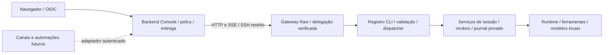

# Console → gateway Ravi

Implementação da arquitetura aprovada em 31/10/2026. Esta versão substitui o wire
protocol `ravi-human-bridge/2` por HTTP/SSE `ravi-console-gateway/1`. Precisa do Ravi
da branch `feat/console-gateway`, baseada no PR Ravi #761, e deste cliente Fleet,
baseado no PR Fleet #3. Publicar estes commits não habilita a instalação.

## Contrato e cobertura

O registro decorado Ravi é a fonte dos comandos, schemas e metadata de acesso.
Fleet verifica a assinatura do catálogo da instalação e seleciona uma decisão de
policy pelo recurso/ação declarados, sem manter outro catálogo RPC. O dispatcher
Ravi valida o body plano. TypeScript, Dart, Swift e OpenAPI são gerados desse
mesmo registro. `sessionView` também pertence ao registro canônico de streams.
O cliente Fleet usa HTTP genérico para consumir o catálogo remoto; não tem uma
segunda implementação dos handlers nem depende de uma versão publicada no npm.

| Superfície canônica | Disponibilidade e condição |
| --- | --- |
| `sessions.conversations.agents/list/create/open/history/send/events/renew/cancel/decide/receipt` | Adapter do armazenamento privado, sujeito/projeto/enrollment e concessão atual |
| `sessions.set-model/set-thinking/set-display` | Handlers existentes; só a conversa vinculada ao grant, com `runtime.sessions.configure`; propagação para agente/irmãs recusada |
| `GET /api/v1/_stream/session-view` | Journal filtrado, cursor vinculado ao owner/projeto/enrollment/epoch; leitura não renova execução |
| Outros comandos do gateway, sessões comuns/Slack/CLI, fork/reset/rollback | Sem binding de recurso revisado nesta entrega: não anunciados pelo catálogo remoto, acesso negado |
| `CliOnly`, superadmin, streams de debug | Não expostos a esta autoridade |

Configuração de sessão opera depois da materialização da sessão pelo runtime.
Não há novos botões de modelo/raciocínio/nome na tela de conversas: esses comandos
estão disponíveis pela API autorizada. A nova permissão tem rótulo no editor
existente e não é concedida automaticamente por poder enviar mensagens.

## Autoridade

O backend revalida sessão OIDC, usuário, membership, projeto, instalação,
credencial e revisão/digest da policy antes e depois do handshake SSH. Uma prova
Ed25519 fixa identidade do runtime, nonce da conexão e digest do catálogo. Só
então o Console assina a decisão por até 30s, com org, instalação, enrollment,
epoch, sujeito, projeto/recurso, comando/ação, policy, origem e digest dos bytes
HTTP (método, path/query, body, operação e criação). Cada tentativa usa novo JTI.
A permissão da conta SSH é apenas transportar bytes; o comando forçado continua
`ravi bridge serve-stdio`. Não aceita destino escolhido pelo navegador.

O listener privado só aceita delegações Console. O listener normal da CLI só
aceita seus contextos locais. A autoridade verificada atravessa o dispatcher em
AsyncLocalStorage: campos enviados pelo cliente não podem fabricar esse contexto.
Acesso remoto não recorre ao operador local. Controle e capacidades do turno são
separados. Grants de execução/approval vêm exclusivamente da policy Console;
child context atenua a concessão. Aprovação vincula ação/digest/versão/turno/prazo.
Providers sem isolamento continuam recusados pelo runtime nativo; esta entrega
não amplia suporte de provider.

Restrições de policy mais novas são persistidas mesmo se o comando for negado.
Sem renovação, a execução expira em até 30s mais o tick de 250ms. Ler/reconectar
SSE não renova o lease. Após perda de acesso, nem recibos podem contornar a nova
decisão. Histórico privado continua inacessível aos comandos locais/admin.

## Confirmação, deduplicação e retomada

- Console: migration `0077_gateway_deliveries.sql` guarda sujeito/escopo, origem,
  operation ID, digest e estado pending/acknowledged/rejected. Não guarda prompt,
  resposta ou resultado privado. IDs de entrega de canal/automação não podem
  ser reapresentados como outra operação. Confirmação não é demovida por retry.
- Ravi: `bridge.db` preserva conversas, mensagens, eventos, aprovações e recibos.
  Envio admite mensagem, turno e recibo atomicamente. Operação repetida devolve
  recibo; mesmo ID com outro payload conflita. Namespace de controles e de
  conversas não pode reutilizar a mesma operação.
- Controles existentes: admissão durável precede o handler. Se não há recibo final,
  o resultado é desconhecido e o handler não é reexecutado automaticamente.
  Falha após efeito nunca retorna a afirmação “nenhum efeito”.
- SSE lê batches limitados do journal com backpressure. Cursor é HMAC opaco;
  reconexão usa novo grant e conserva cursor. A conexão encerra no máximo ao
  fim da delegação; nenhum evento bruto de provider/ferramenta/raciocínio entra
  nessa visão. Aprovação/conclusão e histórico derivam da mesma execução.

`origin` aceita browser, channel ou automation sem depender de sessão web no
Ravi. O adaptador HTTP Fleet implementado autentica browser por OIDC. Novos
adaptadores terão de verificar seus próprios principais e usar o mesmo limite
de entrega/execução. Conectores vivos não foram migrados.

## Estado, secrets e operação

Os nomes de configuração/enrollment e o comando SSH foram preservados para o
transporte, mas não há fallback de protocolo. Pins e referências vivem no binding
servidor; chaves SSH e de assinatura ficam no Vault; identidade do runtime e
credenciais de execução ficam na instalação. O navegador só recebe sua sessão
web e dados autorizados. Nenhum valor de secret entra em docs ou logs.

Uma implantação futura exige autorização separada e versões coordenadas: migrar
o Postgres pelo pipeline existente antes de servir o novo Fleet, instalar Ravi
compatível e habilitar/reiniciar apenas a instalação aprovada. O novo SQLite é
aditivo. Não apagar journal/recibos para “resolver” uma tentativa incerta. Em
rollback, parar novas admissões, preservar dados, deixar leases expirarem e
reverter os dois binários juntos. Policies com a nova ação não podem ser lidas
por schemas antigos strict; remover a ação de revisões ativas/drafts antes de
voltar esses leitores. Nenhum desses passos operacionais foi executado aqui.

## Validação reproduzível

- `bun test tests/fleet/gateway-ssh.test.ts`: Node HTTP real sobre SSH restrito,
  pin de host/runtime, proof e streaming antes de terminar; loopback negado na
  entrada de produção. Node 24 é o runtime usado pelo Next; o shim node:http do
  Bun não implementa o custom Agent sobre Duplex usado neste teste.
- `bun tests/fleet/run-postgres.ts --gateway-backend`: autoridade atual e assinatura
  reais sobre Postgres de teste; Vault/SSH simulados; revogação entre handshake e
  assinatura e resultado desconhecido conservado como entrega pendente.
- `bun tests/fleet/run-postgres.ts --gateway`: Postgres descartável, migrations,
  dedup e confirmação; zero conteúdo privado na tabela.
- `FLEET_TEST_RAVI_SOURCE=<checkout-ravi> bun test --preload <checkout-ravi>/src/test/isolated-runtime-preload.ts tests/fleet/gateway-ravi.integration.test.ts`:
  listener Ravi, SQLite e transporte Fleet reais; executor de turno é fixture.
- `bun tests/fleet/run-postgres.ts --human-bridge-browser`: Next/OIDC/Postgres e
  browser reais, respostas remotas simuladas; desktop/mobile e estados da UI.
- Ravi: `src/sdk/gateway/console.test.ts` e `src/bridge/service.test.ts` cobrem
  dispatcher, isolamento, replay, cursor, revogação, aprovações e incerteza.

Os resultados/hashes desta entrega ficam no relatório do workspace. Testes
anteriores de modelo real e o documento v2 são históricos, não provas destes
commits. Esta rodada não executou modelo real, não alterou VPS/produção e não
realizou deploy. Antes de habilitar uma instalação, repetir a homologação com
seu provider/sandbox e identidades sintéticas nesse ambiente autorizado.

Os DTOs de UI e o envelope de autoridade são sincronizados com
`bun scripts/sync-ravi-gateway.ts <checkout-ravi>` usando RAVI_STATE_DIR
descartável com prefixo gateway-. `--check` compara o resultado sem escrever.
O script usa o codegen Ravi existente; não mantém schemas manuais de comandos.
