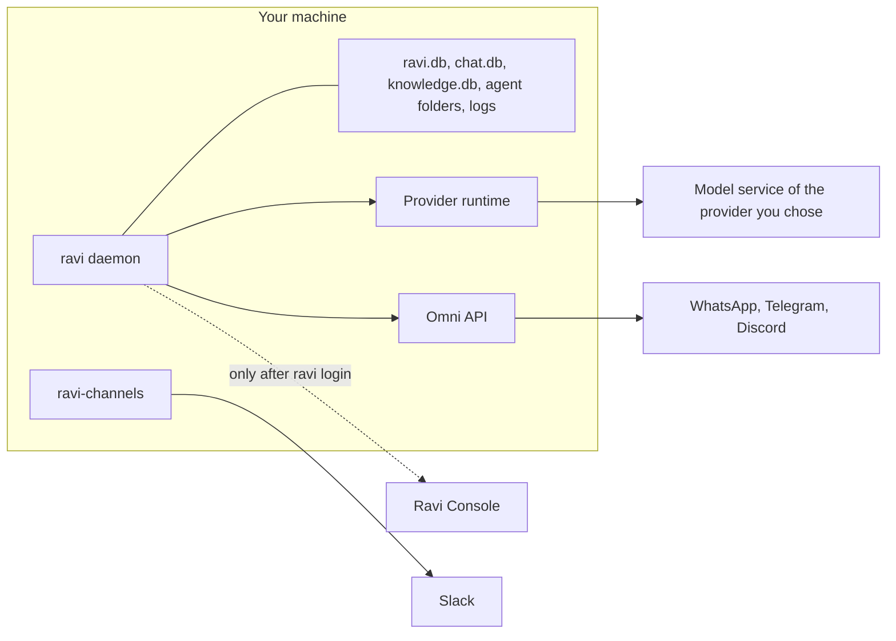

This page lists the destinations a Ravi machine sends data to, with the fields and the schedule. Start here for a security review.

<Note>
This page describes `ravi.bot@next`. It covers what the machine sends. It does not cover how the Console stores what it receives or how long it keeps it.
</Note>

## The short version

- Without `ravi login`, nothing goes to the Ravi Console. Data goes to the model provider you choose, the chat platforms you connect, and the few services under [Other outbound requests](#other-outbound-requests).
- After `ravi login`, the daemon calls the Console on a schedule. It sends a short report of the agents you listed and the names of your instances. It pulls pending items, such as events and requests for agents you opened.
- Message content goes to the Console only through features you use, such as publishing, open agents and Knowledge gaps, or through trace sync.
- Ravi has no analytics or crash-reporting client of its own.

## Stays on the machine

Your state lives in SQLite and files under `~/.ravi` (`RAVI_STATE_DIR` moves it). Ravi's own code never uploads these databases as files. It sends only the fields named in the sections below, such as an `AGENTS.md` you publish with `ravi agents publish`.

| Data | Where it lives |
|---|---|
| Agents, instances, routes, contacts, triggers, settings and sessions | `ravi.db` |
| Message history | `chat.db` |
| Session traces: each turn's events, tokens and cost | `ravi.db` (`session_events`, `session_turns`) |
| Permission denials | `permission_denials` in `ravi.db`, and the NATS subject `ravi.audit.denied` |
| Contact memory and the local Knowledge index | `knowledge.db` |
| Agent instructions (`AGENTS.md`, `HEARTBEAT.md`) and working files | Each agent's working directory |
| Secrets stored with `ravi credentials` | The macOS Keychain, or your own Vault server at `VAULT_ADDR` |
| The Console login | `~/.ravi/cloud-auth/`, file mode `0600`. `RAVI_CLOUD_AUTH_BACKEND=keychain` or `libsecret` moves the tokens to the OS keyring when one is available. |
| Cost and token metrics | `cost_events` and `daily_metrics` in `ravi.db`, read by `ravi metrics` and `ravi costs` |
| Logs | PM2 log files. `ravi daemon logs --path` prints where. |

NATS runs at `NATS_URL`, by default `nats://127.0.0.1:4222` on the same machine. Events on it stay there unless you point `NATS_URL` at another server.

## Goes to the model provider you choose

Each turn runs in the runtime of the agent's provider: Claude Code, Codex, Pi or Grok. The runtime uses that provider's own credentials and sends the turn to the provider's model service.

| What goes | When |
|---|---|
| The message, the conversation so far, and the instructions and chat context Ravi adds | Every turn |
| Files the agent reads and the output of the tools it runs | When the agent uses them |
| Turns that nobody typed: cron jobs, triggers, heartbeats and requests from other machines | On their schedule |
| Direct messages from contacts to the agents in `knowledge.contactMemory.agents`, read by the nightly Knowledge curator | Daily after 03:00, only when `knowledge.curator.agent` is set |

Review each runtime's own data settings with its vendor. For provider credentials, see [Install Ravi](/start/install).

## Goes to the chat platforms you connect

Replies and messages go out through the channels you connect. Slack is native; WhatsApp, Telegram and Discord go through Omni.

| Platform | Path | What goes |
|---|---|---|
| Slack | The `ravi-channels` runner and `ravi slack` commands call `https://slack.com/api` | Replies, edits and deletions, files, reactions, status updates, and what agents post with `ravi slack` commands |
| WhatsApp, Telegram, Discord | The daemon calls the Omni API named by `OMNI_API_URL` or `~/.omni/config.json`, and Omni sends to the platform. `ravi setup` runs Omni on the machine, at `127.0.0.1:8882`. | Replies, edits and deletions, media and stickers, reactions, typing indicators and read receipts |

## Goes to the Ravi Console, after ravi login

Nothing goes to the Console before `ravi login`. Every Console runner in the daemon checks for a login first and skips the call when there is none. Calls go to `https://console.ravi.bot`, or to the URL you passed to `ravi login --console <url>`.

### At login

`ravi login` sends these fields about the machine:

| Field | Value |
|---|---|
| Name | `RAVI_CLI_INSTALLATION_NAME`, or the hostname when it is not set |
| Hostname | The machine's hostname, always, even when you set a name |
| Platform | Operating system and CPU, such as `linux-x64` or `darwin-arm64` |
| Ravi version | The running version, when the CLI knows it |
| Fingerprint | A random key created on the first login and kept in `~/.ravi/cloud-auth/installation-key`. It is not derived from hardware, and it stays after `ravi logout`. |

A token refresh sends only the refresh token and the installation id. It runs when a call finds the access token expired.

### Background calls while logged in

These calls run without anyone typing a command. The table lists each one.

| Call | Schedule | What the machine sends | What comes back |
|---|---|---|---|
| Agent report and Library pins | At daemon start, then every 5 minutes | For up to 500 agents you listed, with `ravi agents listing <id> on --execute` or `ravi agents requests <id> on --execute` (opening an agent also lists it; none by default, and on upgrade agents already open to requests stay listed): id, name, provider, model, Console project, directory description (at most 300 characters) and whether it takes requests | The Library items pinned to each agent, which are then downloaded |
| Requests between machines | Same schedule as the agent report | The answers your open agents write (at most 16,000 characters each), or a failure reason (at most 500) | Answers to requests you sent, and requests for your agents |
| Agent Inbox | Every 15 seconds, when the login holds the `console.inbox.*` scopes | The installation id, a cursor, and the ids and status of items received | Events such as Bases row changes, mail, meetings, Knowledge and watches. The daemon may then fetch the mail message, row or recording an event points to. |
| Knowledge mirror | 5 seconds after the leader daemon starts, then every 15 minutes | The name and channel of each enabled instance (up to 50) | The Knowledge pages marked for those instances |
| Knowledge gaps | With the mirror, when `knowledge.project` is set | Each question a contact asked that the agent could not answer (at most 1,000 characters), with its instance name | The answer, which the daemon sends to the contact once its page is mirrored |
| Knowledge digest | Once a day at `knowledge.digest.time` (default `08:00`), when an owner contact is set | The time of the last digest | Unanswered questions, pending counts and page marks that need a new approval, for the morning message to the owner |
| `ravi link` checks | Every 3 seconds while a link request waits; every 10 minutes for each linked contact | The request id, or the contact id | Whether the link was approved, denied or revoked |
| Trace sync | Off by default. With `RAVI_SYNC_RUNNER_ENABLED=1`, every 60 seconds. | Session events (see below) | Acknowledgements |

Without the `console.projects.link` scope, the daemon only reads its pins and sends no agent report. It also skips requests between machines. `RAVI_LIBRARY_PIN_INTERVAL_MS` changes the 5-minute schedule for both, with a minimum of 10 seconds.

Gaps come only from conversations that use a Knowledge packet. Questions from a contact who asked to be forgotten are never uploaded.

### What trace sync sends

Trace sync uploads a record for each new session event. It is off unless you set `RAVI_SYNC_RUNNER_ENABLED=1` or run `ravi sync push --traces --execute`.

| Included | Not included |
|---|---|
| Session, agent, run, turn and message ids | The full prompt: only its SHA-256 hash and length |
| Channel, account, chat and thread ids, and the chat name | Values under secret-like keys such as `token`, `password` or `apiKey` |
| Contact id, actor type and platform identity id | Inline tokens such as `Bearer ...` and `sk-...` |
| Provider and model | Home-directory paths under path keys such as `cwd` |
| A preview of each event, at most 500 characters | |
| Tool names, and previews of tool input and output, at most 500 characters each | |
| Tokens and cost at the end of each turn | |

`RAVI_SYNC_RUNNER_INTERVAL_MS` changes the 60-second interval.

### When you use a feature

These calls happen only when you, or an agent, run the command. Braked commands print a plan and exit 3 until you add `--execute`.

| Feature | What goes to the Console |
|---|---|
| Pages (`ravi pages ship`, `ravi pages chat`, `ravi artifacts publish`) | The page files you publish, and Page Chat settings: assistant name, voice, language and instructions |
| Bases (`ravi bases`) | The bases, properties, views and rows you create or write |
| Library publishing (`ravi skills publish`, `ravi agents publish`, `ravi themes`, `ravi widgets`) | The skill folder. For an agent definition: its `AGENTS.md`, `HEARTBEAT.md` and suggested provider, model, profile and skills. Theme and widget files. |
| Library pins (`ravi skills pin`) | An agent report, then the id of the agent to pin |
| Directory listing (`ravi agents listing <id> on --execute` or `off`, `ravi agents requests <id> on --execute` or `off`) | An agent report of the listed agents, sent at once when the login holds `console.projects.link` |
| Asking another machine (`ravi agents ask`) | Your message (at most 8,000 characters), the target machine and agent, and the asking agent's id when an agent asks |
| Knowledge (`ravi knowledge search`, `read`, `propose`) | The query or the text you propose, plus the turn's agent id, session name and contact id. Never a Console user id. |
| Cloud meetings (`ravi meetings join`) | The meeting link, bot name, title, language and start time. The Console's bot joins and records the call, and the recording downloads to the machine. With `--local`, the recorder runs in Chrome on the machine instead. |
| `ravi link` | The contact id, display name and platform identity (channel, account, user id), plus the email the platform reports, if any |
| Sharing and invites (`ravi pages share`, `ravi invites create`, `ravi access request`) | The email addresses, roles, reasons and messages you give |
| Watches (`ravi watch create`: GitHub unless `--placement local`, and any provider with `--placement console`) | The provider, the resource (such as `owner/repo`) and the event types. Ravi also creates a GitHub watch in the Console when an agent runs `gh pr create`, `ready` or `edit`. |
| Ravi Mail (`ravi mail domains`, `ravi mail providers ravi-mail`) | The domain and mailbox names you create, and the recipients, subject and body of mail you send through it |
| MCP bridges (`ravi bridges create`) | The bridge name, description and allowed capability classes |
| Bug reports and feedback (`ravi bug`, `ravi feedback`) | What you put in the report. `ravi bug comment` redacts tokens and keys before it sends. |

When someone other than you wrote the message the agent is answering, each of these calls also sends that person's contact id, so the Console can credit the write to their linked account.

Connectors (`ravi connectors`, `ravi gmail`) go to Ravi's connector service at `https://link.ravi.so`, signed with your Console login. Each action sends its arguments, such as the email to send, with the turn's agent id and contact id. See [Connect your accounts](/console/connectors).

## Other outbound requests

A few requests go to services that are neither your model provider nor a chat platform.

| Request | When | What goes |
|---|---|---|
| Model price list from `raw.githubusercontent.com` | When sessions run or `ravi costs` computes cost. A successful download is reused for 6 hours. | A plain download with no data of yours. The copy is cached in `~/.ravi/pricing/`. |
| GitHub, through the `gh` CLI | Every 60 seconds, for local GitHub watches and pull request follow-ups. Ravi creates both when an agent runs `gh pr create`, `ready` or `edit`. | Reads of the watched repository's pull requests and workflow runs, with your `gh` login |
| Transcription of voice messages | Each audio or voice message that arrives from a chat, when `GROQ_API_KEY` or `OPENAI_API_KEY` is set | The audio, to the transcription service of that key ([Media](/reference/media)) |
| Media and voice tools (`ravi audio`, `ravi image`, `ravi video`, `ravi transcribe`) | Only when you or an agent run them | Their input, to the external model service each one uses |
| Other integration commands, such as `ravi yt` and `ravi devin` | Only when you or an agent run them | Their arguments, to the service each one is for, with the credentials you configured |
| `ravi sandbox run` | Only when you run it | The repository URL, the task, your Claude credentials, and `GITHUB_TOKEN` for a private `https://github.com` repository, into a disposable E2B sandbox |
| `ravi update` | Only when you run it | A request to `registry.npmjs.org` for the release you install. A source checkout runs `git fetch` and `git pull` from its `origin` instead. |
| Agent tools | When the agent uses them | Whatever the agent puts in a web fetch, a shell command such as `curl`, or an MCP server call |

The agent's ceiling decides which built-in tools and shell commands it may run. MCP servers that the runtime loads from its own configuration are not checked against the ceiling. See [Permissions](/guides/permissions).

## What Ravi never sends

These are limits on Ravi's own code. They hold for every call listed on this page.

| Never sent | Detail |
|---|---|
| Credential values | Model provider keys and logins, channel tokens, and Keychain or Vault secrets never go to the Console. Ravi uses each one only with the service it belongs to. The exception is `ravi sandbox run`, which passes your Claude credentials and `GITHUB_TOKEN` into the sandbox you start. |
| The local databases | `ravi.db`, `chat.db` and `knowledge.db` are never uploaded as files or in bulk. |
| Paths and instructions in the agent report | The report carries only the seven fields listed above. |
| Full prompts in trace sync | Only their hashes and lengths. |

<Warning>
An agent with shell or file tools can read anything its OS user can read. It can then put that text in a reply, a page or a request. Use `chat-only` or `explicit-only` for agents that talk to people you do not trust ([Permissions](/guides/permissions)).
</Warning>

## How to turn things off

Each switch below is local to one machine. Environment variables go in `~/.ravi/.env`, then apply them with `ravi daemon restart -m "<reason>"`.

| Goal | Do this |
|---|---|
| No Console traffic at all | Do not run `ravi login`. |
| Stop Console traffic on a machine that logged in | Run `ravi logout`, then `ravi whoami`. Repeat until `ravi whoami` says `AUTH_REQUIRED`, since logout switches to another stored user when there is one. |
| Keep traces on the machine | Leave `RAVI_SYNC_RUNNER_ENABLED` unset, the default. Do not run `ravi sync push --traces --execute`. |
| Stop the Agent Inbox | `ravi inbox disable`, once `ravi inbox status` lists the organization. It covers only the organization of the current login. Inbox events then stop reaching this machine. |
| Keep voice messages on the machine | Remove `GROQ_API_KEY` and `OPENAI_API_KEY` from `~/.ravi/.env` and the daemon's environment. |
| Report less often | Set `RAVI_LIBRARY_PIN_INTERVAL_MS`, for example `3600000` for once an hour. The minimum is `10000`. |
| Remove an agent's directory description | `ravi agents set <id> description clear` |
| Close an agent to other machines | `ravi agents requests <id> off`. Every agent starts closed. |
| Take an agent out of the report | `ravi agents listing <id> off`. Every agent starts unlisted. |

`ravi logout` asks the Console to revoke the login and deletes the local tokens, even when the revoke fails. The installation key file stays.

With no agent listed, the agent report is empty, but the daemon still calls the Console for pins and requests. While a login exists, there is no switch that stops those calls or the Knowledge mirror alone. To stop them, log out.

## Next

- [Ravi for organizations](/organizations/overview): what lives on each machine and in the Console.
- [Security](/organizations/security): ceilings, the write brake, audit and credentials.
- [Log in to the Console](/console/login): where the login lives and how to log out.
- [Permissions](/guides/permissions): what each agent may do in a turn.
