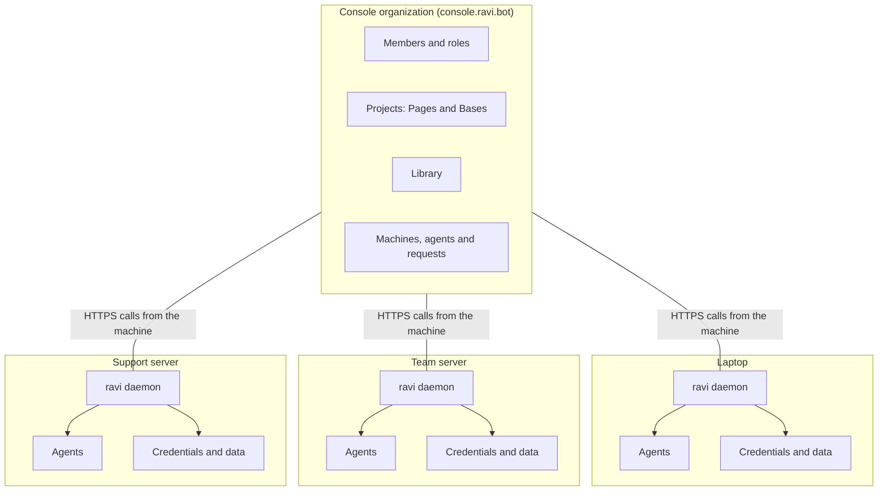

Run agents on as many machines as your teams need, and connect them all to one Console organization. Each machine keeps its own agents, credentials and history. The organization sees the agents each operator lists, lets agents on different machines ask each other, and shares one Library of skills, agents, themes and widgets.

Each machine runs the Ravi daemon and sets its own permission ceilings. The [Ravi Console](https://console.ravi.bot) holds the organization: members, projects, the Library, and the list of machines and their agents. [What leaves your machines](/organizations/data-flow) lists everything a machine sends, and when.

<Note>
This page describes `ravi.bot@next`.
</Note>

## How it fits together

A machine joins with `ravi login` and works in one organization, the one picked in the browser. From then on its daemon calls the Console on a schedule. It reports the agents its operator listed, reads the machine's Library pins and picks up requests from other machines. No agent is listed by default.

## What lives where

Agents, conversations, and model and channel credentials stay on the machine. The Console keeps what people and machines share. Tokens of [connected accounts](/console/connectors), such as Gmail, are the exception: they stay in Ravi's hosted connector service.

| On each machine | In the Console organization |
|---|---|
| The daemon and the channel runner, under PM2 | Members, their roles and pending invites |
| Agents: instructions (`AGENTS.md`), folder, provider and model | Projects, with their Pages and Bases |
| Sessions, message history and traces, in SQLite under `~/.ravi` | The Library: skills, agent definitions, themes and widgets |
| Instances, routes, contacts, triggers and settings (`ravi.db`) | The machines linked with `ravi login` |
| Model credentials and channel tokens | The agents listed on each machine: id, name, provider, model, project, description and whether it takes requests |
| Permission ceilings, denials and audit events | Which Library skill is pinned to which agent |
| Cost and token metrics | Requests between machines, page shares and access requests |

The agent report never carries instructions, paths or credentials. Session traces, with each turn's tokens and cost, stay on the machine by default. They are uploaded only when you set `RAVI_SYNC_RUNNER_ENABLED=1` or run `ravi sync push --traces --execute`.

## What works today and what does not

Linking machines, sharing a Library and asking across machines work now. Machine identity owned by the organization does not exist yet.

| Capability | Status | How it works today |
|---|---|---|
| Machines join the organization | Ready | `ravi login` sends the machine's name, hostname, platform, Ravi version and a random key kept on the machine. |
| The Console knows each machine's agents | Ready | An agent shows only after its operator lists it with `ravi agents listing <agent> on --execute`. While logged in with the `console.projects.link` scope, the daemon reports up to 500 listed agents at start and every 5 minutes. `ravi agents directory` lists them, online or offline. |
| Agents ask agents on other machines | Ready | `ravi agents ask <machine>/<agent> "<message>" --execute`. The asked agent answers as the person who asked, not as its operator. |
| Opening an agent to requests | Ready | Every agent is closed by default. Its operator opens it with `ravi agents requests <agent> on --execute`, which also lists it. |
| Organization and project Library | Ready | Skills pinned to an agent load on its machine; a new pin needs the agent listed. Agent definitions install with `ravi agents install`. Themes and widgets apply when a page ships. |
| Members and access | Ready | Five roles (`owner`, `admin`, `developer`, `viewer`, `billing`), invites, sharing a private page by email, and access requests. |
| Members-only data pages | Ready | Live Bases data reaches only signed-in members. `ravi pages ship` refuses a public route that reads Bases, unless you pass `--members-best-effort`. |
| Governance on each machine | Ready | A permission ceiling per agent, the write brake (exit 3 until `--execute`), and denials recorded in `ravi.db` and published on `ravi.audit.denied`. |
| Machine identity owned by the organization | Not yet | Today a machine is linked by the Console user who ran `ravi login`. Admin approval and revocation that survives a new login are not built. |
| Fleet view | Not yet | The Console has no health or metrics view of your machines. `ravi agents directory` shows each agent as online or offline. |
| Pages chat with the organization's agents | Not yet | Page Chat lets a signed-in member talk by voice to an agent that operates the page. It does not reach the agents on your machines. |

## Open source and hosted

The daemon, the CLI and the SDKs are MIT-licensed and run without the Console. The organization, Pages, Bases, the Library and requests between machines need `console.ravi.bot`.

| Part | License | Needs the Console |
|---|---|---|
| Daemon, CLI and channel runner | MIT | No |
| SDKs for TypeScript, Dart and Swift, and the HTTP gateway | MIT | No |
| Sessions, cron, triggers, heartbeats, permissions and local audit | MIT, part of the daemon | No |
| The organization, members, invites, page sharing and access requests | Hosted | Yes |
| Pages, Bases, the Library, the agent directory and requests between machines | Hosted | Yes |

## Next

- [Machines](/organizations/machines): link a machine, name it and list its agents.
- [Data flow](/organizations/data-flow): what each machine sends to the Console, and when.
- [Security](/organizations/security): ceilings, the write brake, audit and credentials.
- [Log in to the Console](/console/login): create the organization and run `ravi login`.
